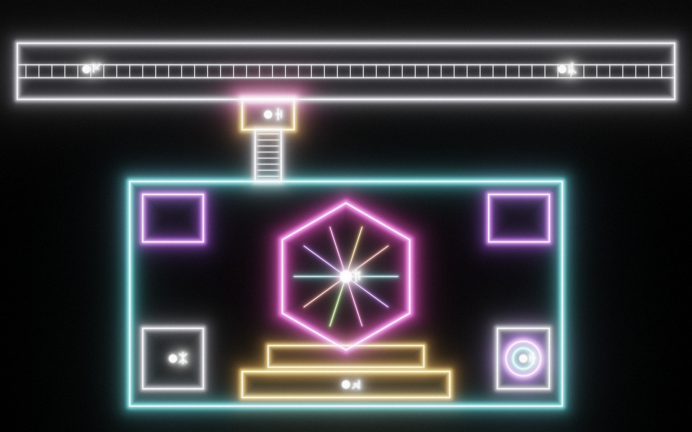
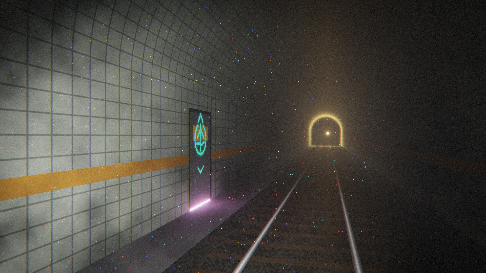
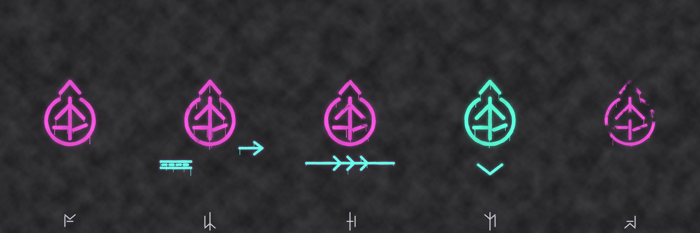
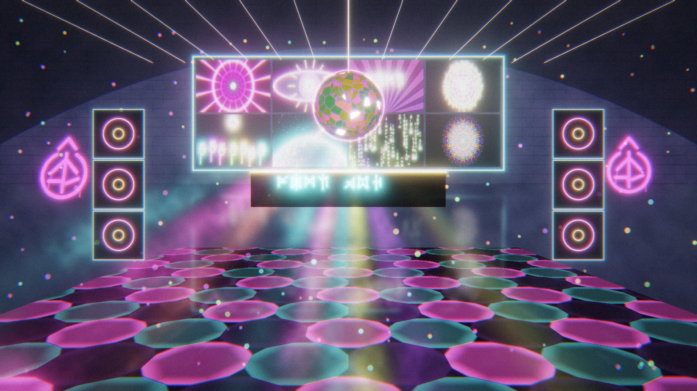

# Ash Meridian — Resistance Club: Implementation Handoff (for Cursor)

Status: art and plan complete; **no game code written yet**. This document is the
build spec. Canon lives in [ASH_MERIDIAN_PROPOSAL.md](../ASH_MERIDIAN_PROPOSAL.md)
(optional club section) and [ASH_MERIDIAN_APPROVAL_DRAFT.md](../ASH_MERIDIAN_APPROVAL_DRAFT.md)
(§6A, reveal order). Route constraints: [ASH_MERIDIAN_UNDERGROUND_HANDOFF.md](../ASH_MERIDIAN_UNDERGROUND_HANDOFF.md).

Music is **not delivered yet**. Every effect must run from a synthetic beat clock
now and switch to real audio analysis automatically when the track file appears.

---

## 1. Story context (what the room must communicate)

- As Narceans were converted to cyborgs, the resistance met in illegal
  underground clubs. The planetary AI tolerated them as a nuisance, not a threat.
- MJH planned the escape here and learned the route to the surface. His job was to
  befriend the local surface FEB and bypass its governor. That FEB is the
  **flight FEB**; it flew the Narceans off-planet.
- MJH was captured before boarding and converted into the governed **local
  defense FEB** that attacked the ship. That FEB is Rob. The player must not
  learn this here; the club only seeds deniable hints.
- The club is **optional**. It is not a fourth required level, and no story beat
  may depend on visiting it. The club track is Rob's memory motif, and a
  non-club equivalent exists elsewhere.
- No crowds, no NPCs, no cinematics. The room is abandoned. The effects
  rig boots up and plays the last set on a loop. Records (§9) carry the narrative.

## 2. Location and route



Legend (the Narcean digit next to each white dot in the plan image):

| # | Area | Notes |
|---|------|-------|
| 1 | Tunnel, west | First tunnel tag (`resistance_mark_1`, arrow to the line) |
| 2 | Tunnel, east | Chevron tag (`resistance_mark_2`) |
| 3 | Hidden door alcove | Cyan mark painted over the amber service sign (`resistance_mark_3`). Warm magenta light leaks under the door once powered |
| 4 | Dance floor + orb | Hex floor, orb hangs above centre |
| 5 | DJ booth + video wall | Booth console = power/playback interaction |
| 6 | Telepad room | Portal ripple pad, leads to the surface launch deck (later level) |
| 7 | Lounge / records | MJH recordings, flyers, data consoles |

Tunnel concept: 

**Placement (recommended; verify in-game):** B13 Undercity, floor code `88216`
in [deep_stratum.vg](../../../samples/games/ash_meridian_part1/deep_stratum.vg).
- `_uc_cell()` marks tunnel cells as type `1`.
- The east run `i = 54, j = 4..34` (world x ≈ 96, z ≈ 16–136) is a live train
  line (`_train` path 1 runs along x = 98).
- Put the hidden door on that tunnel wall, around z ≈ 100. Use a tunnel cell, not
  a station.

**Implementation pattern:** make the club its own floor code, for example `"77124"`.
- Add a `_layout_club(city)` function and an `ElseIf code = "77124"` branch in
  `_layout()`.
- The hidden door is a `_portal(...)` in `_layout_undercity` with a `"club"`
  key and anchor. Return from the club works the same way.
- This keeps club geometry, materials and per-frame effects out of the B13 hot
  path. That matters for performance, because B13 is already the heaviest floor.

**Graffiti trail (must be forgiving):**
- `resistance_mark_0`: a plaza or concourse wall near the B13 arrival, readable
  at a distance.
- `resistance_mark_1`: the station platform wall nearest the east line.
- `resistance_mark_2`: inside the tunnel, about 30 m before the door.
- `resistance_mark_3`: on the door.
- `resistance_mark_4`: small faded repeats as reassurance, 2–3 placements.

The door must be findable just by walking the tunnel, without the clues: use the
light leak and an audible muffled bass once powered (§5.5).
Orac translates on look, reusing the `_graffiti(..., translation)` pattern. Suggested lines:
- 0: "GRAFFITI: THE EYE OPENS BELOW."
- 1: "FOLLOW THE LINE."
- 2: "KEEP WALKING. DON'T STOP FOR TRAINS."
- 3: "KNOCK TWICE. WE ARE STILL HERE."
- 4: "STILL HERE."



## 3. Room design



The room is a vaulted brick hall of about 20 × 10 m with 6 m ceilings, scaled from
the plan at 1 px ≈ 2 cm. It contains:
- **Entrance landing + stair (#3 → down):** the player enters high and looks
  down on the floor. This is the money shot in the concept.
- **Dance floor (#4):** a hex-tiled emissive glass floor about 8 m across,
  sunken one step.
- **Orb (#4):** a large faceted "alien disco ball" about 1.4 m in diameter,
  hung about 4.2 m up. It rotates slowly, and its facets include organic "eye"
  cells and veins.
- **DJ booth (#5):** a two-tier riser on the back wall. A glyph light bar runs
  along the front of the booth, and the video wall sits behind it. The wall is
  4 × 2 panels in the concept; in-game, use one quad sized about 8 × 2.25 m.
- **Speaker stacks:** 3 high, on either side of the booth. The cones pump with
  bass.
- **Resistance mark neon signs:** magenta, on the side walls. Inside the club the
  mark is used openly.
- **Fog:** low ground fog over the floor plus a haze volume for the beams.
- **Corner rooms:** the lounge/records room (#7, bottom-left) and the telepad
  room (#6, bottom-right). Top corners are storage or bar alcoves.
- **Palette:**
  - Narcean infrastructure keeps cyan and amber.
  - The club adds UV `#9E38FF`, magenta `#FF2EB8`, acid green `#8CFF40` and
    coral `#FF5C4D`.
  - Those values match `UV / MAGENTA / ACID / CORAL` in
    [club_art.py](../../../samples/games/ash_meridian_part1/tools/club_art.py).
- **Signage:** all text is Narcean glyphs (`glyph3` / `_sign`), with English
  only through Orac.

## 4. Assets

Generated by [tools/club_art.py](../../../samples/games/ash_meridian_part1/tools/club_art.py).
The script is deterministic.
- Re-render everything: `python3 tools/club_art.py`, run from the game folder.
- Textures only: `python3 tools/club_art.py textures`.

Outputs go to `samples/games/ash_meridian_part1/assets/club/`.

| File | Size | Use / channels |
|------|------|----------------|
| `resistance_mark_0..4.png` | 1024² RGBA | Spray graffiti decals (premultiply off; alpha = paint) |
| `videowall_atlas.png` | 2048×1152 | 4×4 grid of 512×288 panels; see the panel index below |
| `orb_albedo.png` | 1024×512 equirect | Dark chrome facets with thin-film sheen |
| `orb_emission.png` | 1024×512 equirect | Base emissive (eyes + veins), scaled by shader |
| `orb_mask.png` | 1024×512 equirect | R = facet random id (0–1), G = eye cells, B = veins |
| `gobo_spots.png` | 512² gray | Light cookie for orb reflections or spots (projector texture or decal) |
| `dancefloor_mask.png` | 1024² RGBA, tileable | RGB = 3 tile groups (one-hot per hex), A = grout/rim |
| `fog_noise.png` | 512² gray, tileable | Scrolling fog density |
| `flyer_0..2.png` | 512×768 RGBA | Wall or floor flyers (alpha = torn corner) |

Video wall panel index, row-major (`index = row * 4 + col`):

| Index | Panel | Index | Panel |
|-------|-------|-------|-------|
| 0 | tunnel | 8 | glyph_rain |
| 1 | eye | 9 | slogan |
| 2 | mandala | 10 | route |
| 3 | planet | 11 | storm |
| 4 | feb_cross | 12 | rings |
| 5 | waveform | 13 | hands |
| 6 | face | 14 | eye_alt |
| 7 | kaleido | 15 | mandala_alt |

**Story-sensitive panels:**
- 4 (`feb_cross`, a struck-through FEB) is resistance propaganda.
- 10 (`route`) is the surface-route schematic, the tunnel → telepad → deck briefing.
- 6 (`face`) is an anonymous Narcean face drawn in contour lines. It must **not**
  read as MJH or Rob.

Put 4 and 10 in the rotation but not too often.

Godot import settings:
- Use mipmaps and filter on for everything.
- For `dancefloor_mask` and `fog_noise`, set repeat to enabled.
- For `orb_*`, set repeat to enabled on U only. If per-axis repeat is not
  available, clamp in the shader.

## 5. Audio-reactive architecture

### 5.1 Feature bus (single source of truth)

Create a small module, `club_fx.vg`. Follow the lazy-spawn, own-RNG pattern of
[undercity_fx.vg](../../../samples/games/ash_meridian_part1/undercity_fx.vg).
Each frame it publishes:

| Feature | Range | Meaning |
|---------|-------|---------|
| `bass` | 0–1 | Smoothed energy 20–150 Hz |
| `mid` | 0–1 | 150–2000 Hz |
| `high` | 0–1 | 2–12 kHz |
| `beat` | 0–1 | Kick pulse: 1 on onset, exponential decay (~120 ms) |
| `bar_phase` | 0–1 | Position within the 4-beat bar |
| `beat_index` | int | Increments every beat (drives cuts and colour steps) |
| `bpm` | float | Current tempo |
| `section` | int | 0 = intro/low, 1 = groove, 2 = peak (drives intensity tier) |

Push these to every club material through a single shared set of global shader
uniforms. Otherwise, loop over a small array of materials with
`set_shader_parameter`. Effects never read audio directly.

### 5.2 Synthetic fallback (no music yet)

The fallback is used whenever `assets/audio/club/club_track.ogg` is missing.
- Default tempo: 124 BPM.
- Kick on every beat, hats on the off-beats.
- `bass` = kick envelope plus a slow 16-bar swell.
- `high` = hat envelope plus noise.
- `mid` = slow LFO.
- `section` cycles 16 bars low → 32 groove → 16 peak.

Add a light seeded variation, such as fills every 8th bar, so it doesn't feel
mechanical. Also play a quiet procedural kick and hat through the Club bus, so
the room is not silent before the real track arrives. The project already
generates audio procedurally in [game_audio.vg](../../../samples/games/ash_meridian_part1/game_audio.vg).

### 5.3 Real music path

- Drop-in slot: `samples/games/ash_meridian_part1/assets/audio/club/club_track.ogg`.
  Loop it. An optional sidecar, `club_track.json`, can hold `{ "bpm": 124, "offset": 0.0 }`.
- Create a `"Club"` bus that sends to the master or sfx bus. Reuse the
  bus-creation helper in `game_audio.vg` (around line 139). Add an
  `AudioEffectSpectrumAnalyzer` to it.
- Play the track on an `AudioStreamPlayer3D` placed at the booth, with
  `bus = "Club"`. Attenuation should make it muffled in the tunnel and clear in
  the room. Add a low-pass filter on the tunnel side of the door if it's cheap.
- Each frame, call `get_magnitude_for_frequency_range` for the three bands, then
  apply attack/release smoothing (attack ~30 ms, release ~250 ms).
- Normalize each band with a running max, which decays slowly.
- **Onset detection:** use a bass flux threshold, and gate it so beats are at
  least 60% of a beat period apart.
- **BPM:** take it from the sidecar if present. Otherwise estimate it from onset
  intervals, using the median of the last 16 and clamping to 90–150.
- **`bar_phase` / `beat_index`:** derive them from a beat clock that is
  phase-corrected by onsets, not from raw onsets. This keeps visuals locked to
  the tempo.
- **`section`:** derive it from long-window (8 s) bass+mid energy using thresholds.

### 5.4 Power-up interaction

The club is dark until it is powered.
1. The player enters the club. It is unlit except for emergency strips and the
   light leaking from the dead booth.
2. If B13 `grid_power` is already on (`power_up()` at
   [deep_stratum.vg](../../../samples/games/ash_meridian_part1/deep_stratum.vg)
   around line 3132), the booth console is live. Otherwise the booth shows a
   "no power" glyph, and Orac says: "Dead. Whoever ran this place wired it into
   the city grid."
3. The player interacts with the booth. The boot sequence then runs:
   1. Video wall CRT flicker, reusing the `boot_crt.gdshader` style.
   2. Floor tiles light from the centre outward.
   3. Orb motor spins up over 3 s.
   4. Fog machines hiss.
   5. The track (or synthetic set) fades in.

   Orac: "It's still got the last set loaded. Someone left in a hurry."
4. It stays on for the session. Save the state in
   `city.stratum("club_powered")`.

### 5.5 Through-door hint

Once B13 has power, the door alcove (#3) does two things:
- A magenta light strip under the door pulses with `beat`.
- An `AudioStreamPlayer3D` plays muffled kick thumps, with a low-pass at about
  200 Hz and low volume.

It is audible only within about 15 m. It is a reward for exploring, not a beacon.

## 6. Effect specs

All materials are additive or emissive. Keep them unshaded where possible. Reuse
the bloom and vector post pass from Vector Crypt (§7).

### 6.1 Orb (`club_orb.gdshader`, sphere mesh)

- Rotation: `uv.x += TIME * 0.03 + beat_accum * 0.002`.
- Albedo is `orb_albedo`. Metallic 1, roughness about 0.15. The facets get a
  view-dependent fresnel tint in UV/magenta.
- Emission:
  ```
  orb_emission * (0.3 + 1.2 * beat)                // base pulse
  + mask.G * eye_col * (0.4 + 2.0 * mid)           // eyes open on mids
  + mask.B * vein_col * (0.2 + 1.5 * bass)         // veins pulse on bass
  + facet flash                                    // see below
  ```
  For the facet flash: when `fract(mask.R * 37 + beat_index * 0.618) < high * 0.15`,
  add a white sparkle.
- Eye blink: once every 8 bars, the G-channel eyes close. Animate a dark lid that
  grows down the eye's height over 150 ms.
- Reflections: 8–12 spot or "beam" quads radiate from the orb and rotate with it.
  Use a decal using `gobo_spots.png` as the cookie, projected onto the
  walls and floor. Its intensity is `0.3 + bass`.

### 6.2 Dance floor (`club_floor.gdshader`)

- Tile `dancefloor_mask` at about 1 m per hex.
- Each RGB channel is a tile group. Assign the groups a colour from the palette
  that cycles on `beat_index`: group k gets `palette[(beat_index + k) % 4]`.
- Brightness per group is `beat` with a per-group phase offset, so the groups
  chase.
- A radial ripple from the centre on each beat:
  `ring = smoothstep(w, 0, abs(dist - beat_age * 6))`.
- A is the grout: a dim cyan rim with `0.2 + 0.4 * high`.
- Glossy surface: use a ScreenSpaceReflection or a cheap fake that mirrors the
  orb and wall using a blurred emissive texture, whichever the renderer supports.
- Section 0 shows only the ripples. Section 2 is full chase plus strobe-white on
  downbeats, scaled by the accessibility setting (§8).

### 6.3 Video wall (`club_videowall.gdshader`)

- Sample the atlas at
  `panel_uv = (vec2(idx % 4, idx / 4) + uv) / vec2(4, 4)`.
- Cuts:
  - On every bar, pick a new `idx` from the rotation list using a seeded RNG
    with no immediate repeats.
  - In section 2, cut every 2 beats.
  - On a cut, do 2 frames of RGB-split glitch.
- Bass zoom: `uv = (uv - 0.5) / (1 + 0.04 * bass) + 0.5`.
- Hue shift by `bar_phase * 0.1`. Apply a scanline and CRT mask; borrow from
  `vector_monitor.gdshader`.
- Brightness `0.6 + 0.6 * beat`, with high-frequency shimmer on `high`.
- Optional: one panel cell becomes a live waveform drawn from the band history (§5).

### 6.4 Fog

- **Ground fog:** 2–3 stacked transparent planes about 0.1–0.6 m above the floor,
  using scrolling `fog_noise`. Colour comes from the nearest light, with
  approximately the floor's group colours averaged.
- Fog machines: 2 emitters at the speaker stacks. Every 16 bars (or on section
  change) they puff for 2 s using GPUParticles3D with soft billboards and a hiss
  SFX.
- **Haze volume:** if the renderer is Forward+, use a `FogVolume` with low density
  so the beams read. In the Compatibility renderer, fake the beams with additive
  cone meshes.

### 6.5 Beams and strobes

- 6 moving-head beams sit on the ceiling truss. These are cone meshes with an
  additive shader.
  - Pan/tilt follow Lissajous patterns locked to `bar_phase`.
  - Colour steps on beats.
- Laser fan, for section 2 only: thin lines from the booth, in the
  ceiling-lasers style from the concept.
- Strobe: in section 2, flash white on `beat` onsets, capped at **3 Hz**. Scale
  it by the strobe setting (§8).
- Speaker cones: scale `1 + 0.06 * bass` along local Z.

### 6.6 UV graffiti and flyers

- Inside the club, extra resistance marks glow under UV: an emissive multiplier
  `0.5 + 0.5 * mid`.
- Flyers are static decals on the lounge walls (#7) and are readable through Orac.

### 6.7 Telepad (#6)

- Port `portal_ripple.gdshader` from Vector Crypt. It is idle when the
  club is unpowered. When powered, it shows a slow ripple, but is **inert** in
  this pass.
- Interacting with it gives Orac: "Telepad. Destination locked - surface
  coordinates. Needs an access key." It becomes the route to the surface launch
  deck in a later task. The launch deck is not part of this handoff.

## 7. Borrow from Vector Crypt (`samples/apps/vector_crypt`)

| Source | Use |
|--------|-----|
| `vector_monitor.gdshader` | Video wall CRT/scanline look; optionally a subtle full-screen bloom while in the club |
| `portal_ripple.gdshader` | Telepad (#6) |
| `WallPatterns.vg` (`NeonEdge`, `NeonStrip`, `NeonRing`, `NeonCell`, `NeonFace`) | Neon trim on the booth, stage edges, speaker rings, door frame |
| `Main.vg` music calls (`Sound.Play(path, "Music")`, `Sound.Volume`, `Sound.Pause/Resume`, `Sound.IsPlaying`) | Reference only; the club needs a positional `AudioStreamPlayer3D` on the Club bus instead |

Copy them into `samples/games/ash_meridian_part1/shaders/` with a `club_` prefix.
Don't reference across sample folders.

## 8. Accessibility and performance

- **Strobe setting:** add `strobe_intensity` with values Off, Low, or Full.
  Default to Low.
  - Off disables white flashes and caps beam colour-step frequency at 2 Hz.
  - Full flashes no faster than 3 Hz.
- Show a photosensitivity notice the first time the club is powered.
- **Budget:** the club floor must hold the same frame rate as the B13 Undercity.
  - Use 1 sphere, 1 floor quad (or a hex mesh), 1 wall quad, about 10 beams,
    2 particle emitters, and at most 3 fog planes.
  - Use no real-time shadows from the effect lights. Use one omni light only,
    tinted with the average colour.
- Per-frame updates touch at most about 10 materials. Push features once per frame.
- The synthetic clock and analyzer cost should be negligible. Read the analyzer
  once per frame, not per material.

## 9. Records (narrative props in the lounge, #7)

These use existing patterns: `_console_data` and `_sign_data`. The text is fixed;
Orac translates it.
- MJH planning log: "...the surface FEB answers me now. Its governor
  sleeps when I talk about the sky." No mention of his capture.
- A resistance roster with one entry scratched out. It's unreadable. Orac says:
  "The name's been scraped off. On purpose."
- A recorded set list. The last track is the motif, titled with the glyphs for
  "FOR THE ONE WHO STAYS" (dramatic irony; deniable).
- A route map that matches video-wall panel 10.
- **Do not** reveal Rob = MJH. Follow the reveal order in the approval draft.

## 10. Tests (follow the existing `test_*.vg` pattern)

Add `test_club.vg`, using the pattern in `test_deep_stratum.vg`:
1. `_layout("77124")` builds with no errors. The solids index is non-empty, and
   the anchors `club_entry` and `club_exit` exist.
2. The B13 layout contains the club portal and all 5 graffiti placements.
3. Club FX with no track file:
   - The synthetic clock is selected.
   - After 10 simulated seconds at 124 BPM, `beat_index` is 20 ± 1.
   - `bass`, `mid`, `high` and `beat` stay in [0, 1].
4. Sections cycle in the expected bar counts.
5. Strobe Off means the strobe intensity uniform stays at 0 for 60 s of
   simulated time.
6. All the asset files in §4 exist and load.
7. Power gating: with `grid_power = False`, the booth interaction does not start
   playback.

Run the headless suite the repo already uses for the game tests, and the full VG
regression afterwards.

## 11. Acceptance criteria

- [ ] The door can be found with or without the clue trail.
- [ ] The club is dark before power, and the boot sequence plays after the booth interaction.
- [ ] All effects (orb, floor, wall, fog, beams, strobe, speakers, door pulse)
      respond visibly to the synthetic clock now.
- [ ] Dropping in `club_track.ogg` switches to spectrum-driven features with no
      code change, and the visuals stay locked to the music's beat.
- [ ] Strobe setting is honoured, and nothing flashes faster than 3 Hz.
- [ ] The frame rate matches the B13 Undercity.
- [ ] No story spoilers, and all text goes through glyphs and Orac.
- [ ] The tests in §10 pass.

## 12. Open items for the designer

- Confirm the door location (B13 east line) and the club floor code.
- Confirm the room reconciles with the underground handoff's three local levels.
  It does so by being an optional side floor, not a required level.
- Music: supply `club_track.ogg`, plus the BPM if known. Rob's non-club motif
  variant is a separate asset.
- The surface launch deck (destination of the telepad) is a separate task.

## 13. Visual references

| Image | Purpose |
|-------|---------|
| [club_interior_concept.png](club_interior_concept.png) | Mood, palette, composition from the entrance landing |
| [tunnel_entrance_concept.png](tunnel_entrance_concept.png) | Door in the train tunnel, light leak, final clue |
| [graffiti_trail_stages.png](graffiti_trail_stages.png) | The 5 graffiti stages in order |
| [club_layout_plan.png](club_layout_plan.png) | Top-down layout and legend numbering |
