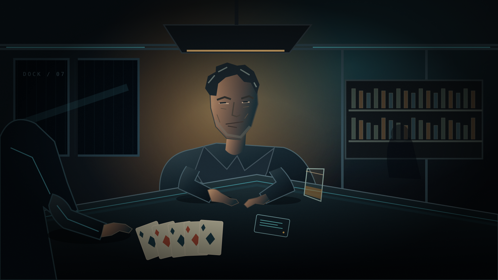
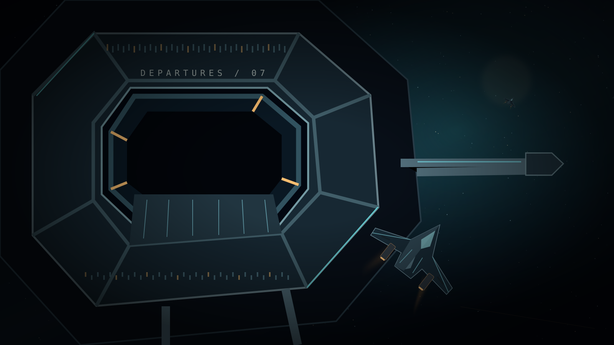
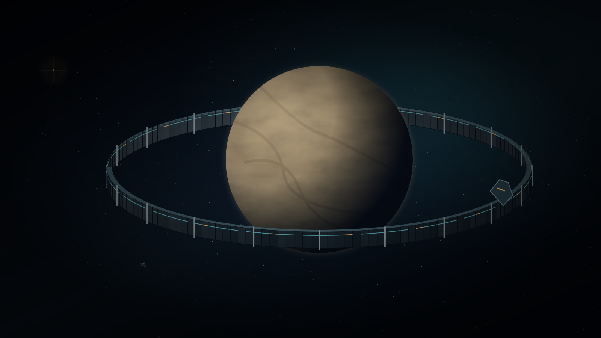
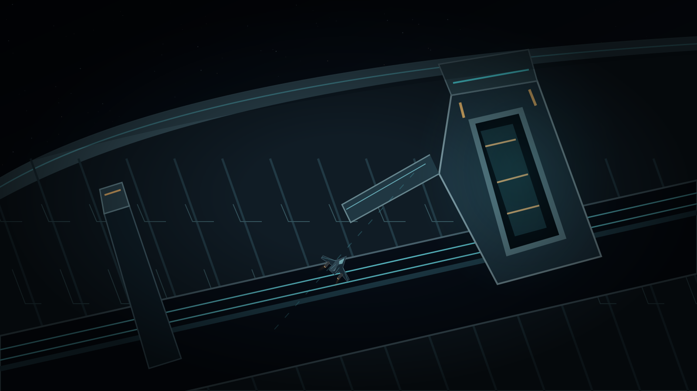

# Cursor handoff: 3D Backlight opening cinematic

> **Status (gate 7):** Cursor's gate 6 character animation was accepted. Gate 7
> replaced only the bar and voyage sets; see
> [OPENING_PRODUCTION.md](./OPENING_PRODUCTION.md#3d-review-gate-6-and-gate-7)
> and [pipeline/](./pipeline/). Future work should build on gate 7 rather than
> start over.

## What we are trying to make

Create a polished, real-time-3D-style opening cinematic for **Ash Meridian**,
which is a 3D game. The scene begins with Mark and Jason playing poker across a
table in a worn station bar. Mark gives Jason the coordinates and warns him
about the danger. The opening then continues through the station departure and
the approach to the enormous ring.

The visual direction is the game's **Backlight** look: solid, readable
industrial forms; dark materials; selective cyan and amber neon strips and rim
lights; atmospheric haze; restrained glow. It should feel like a lived-in
science-fiction location, not a wireframe room or a neon outline around every
surface.

The characters must read as natural, complete people. In particular:

- Heads must have a convincing hairline and scalp coverage. No bald gaps,
  floating hair caps, exposed skin through the hair, or intersecting scalp.
- Shoulders, necks, and upper arms must connect naturally in the seated pose.
  No detached-looking joints, collapsed/clipped shoulders, stretched arms, or
  body parts intersecting the table.
- Hands and wrists must be anatomically plausible at rest and during any card
  action. No twisted wrists, palm-up “display” poses, broken fingers, hands
  floating above the felt, or forearms penetrating the tabletop.
- Dialogue acting should feel restrained and intentional: listening, eye-line
  changes, small head movement, and meaningful pauses. Avoid repetitive
  nodding, constant motion, or unrelated gestures.

The user has no human animator available; AI-assisted/free tools are the
available route. Do not frame a human animator as a dependency. Use suitable
existing character/animation assets where they genuinely help, and verify
their license and pipeline compatibility before relying on them.

## Supplied artwork and source assets

These are already in the repository and can be opened directly. Use them as
the supplied art direction, composition, palette, and story reference. They
are **2D storyboard/key-art references**, not final 3D textures and not a
request to reproduce their drawn anatomy literally.

| Supplied reference | Intended use |
|---|---|
| [table.svg](../../../samples/games/ash_meridian_part1/assets/opening_cinematic/table.svg) | Poker/bar composition, silhouettes, table, faces, cyan/amber balance |
| [station.svg](../../../samples/games/ash_meridian_part1/assets/opening_cinematic/station.svg) | Station departure mood and graphic language |
| [arrival.svg](../../../samples/games/ash_meridian_part1/assets/opening_cinematic/arrival.svg) | Ring arrival scale and staging |
| [approach.svg](../../../samples/games/ash_meridian_part1/assets/opening_cinematic/approach.svg) | Ship/ring relationship and approach |
| [two_shot.png](./character_audition/two_shot.png) | Prior rigged-character/bar lighting look only; not approved anatomy |
| [face_rest.png](./character_audition/face_rest.png), [face_ah.png](./character_audition/face_ah.png), [face_pbm.png](./character_audition/face_pbm.png) | Prior face/viseme audition only; not approved final character art |
| [ash_meridian_opening_animatic_v05.mp4](./renders/ash_meridian_opening_animatic_v05.mp4) | Dialogue, timing, shot order, and departure/space content; its visuals are only a rough animatic |
| [ash_meridian_opening_poker_v01.mp4](./renders/ash_meridian_opening_poker_v01.mp4) | Failure reference only. Do not use its character poses, hair, hand posing, or animation as a target. |

### Supplied visual boards

The following originals are embedded here so Cursor can view the art direction
alongside the brief. Open the linked full-size SVG when checking detail.

**Poker/bar — composition, people across the table, and cyan/amber balance**

**Station departure**

**Ring arrival and approach**

The canonical words, speakers, timings, and voice clips are:

- [script.json](../../../samples/games/ash_meridian_part1/assets/opening_cinematic/script.json)
- [timeline.json](../../../samples/games/ash_meridian_part1/assets/opening_cinematic/timeline.json)
- [voices.json](../../../samples/games/ash_meridian_part1/assets/opening_cinematic/voices.json)
- [voice clips](../../../samples/games/ash_meridian_part1/assets/opening_cinematic/voice/)

Keep the canonical dialogue intact unless the user approves a script change.
The first 15 clips are the poker/bar exchange (about 82.375 seconds); the
remaining clips cover the message, departure, and ring approach. Existing audio
is scratch dialogue, not a final voice performance.

## Honest status / lessons from the failed attempt

Two proxy-character passes were rejected for strange body segmentation and
misaligned shoulders. A later CC0 MakeHuman/MPFB audition improved the overall
bar/set look, but its final poker cut also failed:

- the hair did not sit cleanly on the scalp and skin showed at the hairline;
- the shoulders/arms and hands still looked unnatural;
- wrists and fingers were visibly twisted or posed implausibly;
- hands did not convincingly contact the table/cards;
- bodies and feet appeared through or below the tabletop in some wide shots;
- the sparse hand/head keys produced stiff, weak acting.

That result is [ash_meridian_opening_poker_v01.mp4](./renders/ash_meridian_opening_poker_v01.mp4).
It is **not approved** and must not be presented as a successful review or used
as a source for animation. The audition README has the remaining details and
asset provenance.

The earlier Blender script and generated character files were kept under
`/tmp/ash-character-audition/`, not committed as a reusable production
pipeline. Do not assume those models or rigs are present in the workspace.
The current in-engine bar study is [opening_bar_study.tscn](../../../samples/games/ash_meridian_part1/opening_bar_study.tscn);
it is an isolated study and not the campaign entry point.

## Required low-cost workflow — do not render the full cut first

The previous mistake was spending effort on a long render before the character
design, fit, posing, and movement passed review. Work in short approval gates.
Keep all experiments separate from live game/campaign content.

### Gate 1: character and asset selection

1. Find or create a **small shortlist** of no more than three legally usable,
   humanoid characters. Favor complete, textured characters with fitted hair,
   clothing, facial controls, and a documented skeleton over unrigged
   photoreal scans or parametric base meshes.
2. Record the source URL, license, attribution requirements, file format,
   rig/skeleton, facial controls, and whether redistribution in this project is
   permitted. Do not treat “free download” as a license.
3. Before detailed animation, test the actual candidates in Blender or the
   chosen renderer and produce a contact sheet for each:
   front, profile, rear/three-quarter, seated two-shot, shoulder close-up, and
   hairline close-up under neutral and Backlight lighting.
4. Reject any candidate whose hair requires a floating cap/overlay to hide a
   scalp gap, whose shoulders deform badly in a seated pose, or whose mesh/rig
   cannot produce relaxed, readable hands. Do not try to repair an unsuitable
   base by adding guessed IK targets or hiding defects with lighting.
5. Present the shortlist and contact sheets before committing to a full scene.

### Gate 2: one still frame

Build only the poker-table set and one approved seated two-shot. Match the
storyboard's eye-lines and table composition while making the set genuinely
3D. Verify at the intended final camera resolution:

- both characters sit at believable scale across the table;
- shoulders, necks, hairlines, elbows, and hands all read cleanly;
- forearms meet the table edge naturally without intersecting the table;
- table occlusion is intentional, with no torso or leg/foot fragments leaking
  through the tabletop;
- skin and hair remain visually coherent under the cyan/amber lighting;
- Backlight is expressed through the set, selected edges, and rim light, not
  by outlining every body contour.

Do not proceed until this still is convincing.

### Gate 3: 5–8 second motion proof

Animate one short, representative exchange using the existing voice clips. Keep
hands resting naturally or make only one simple, legible card/chip action.
Prioritize correct contact and weight over busy gestures. Render at draft
quality and review the whole clip, not just a flattering still. Check the
hairline, shoulder deformation, wrists/fingers, table intersections, eye-lines,
timing, holds, and transitions between poses.

Reject and revise if any of the listed anatomy/contact defects return. Do not
solve a failed motion pass by cutting around every defect unless the shot plan
is intentionally being redesigned and the user approves.

### Gate 4: scene coverage and full edit

Only after the still and motion proof pass, extend the scene to the full 15-line
bar exchange. Use close-ups, inserts, and reaction shots as intentional
cinematography, while preserving the original poker setup and story. Then make
the departure/ring shots in the same 3D Backlight world; the supplied SVGs are
art-direction references for these shots. Assemble and sync the existing audio
and subtitles. Verify the final full-length encode and inspect frames from every
shot before calling it a review deliverable.

## Technical and scope constraints

- Keep work in a separate review/preproduction location. Do not replace the
  campaign opening or modify unrelated game systems.
- Keep review renders and deliverable references in the central
  `docs/development/ash_meridian_opening/renders/` folder.
- Do not add large character packs, generated meshes, or Blender project files
  to runtime assets without explicit approval and license review.
- Preserve the approved story, dialogue, and Backlight palette. The opening is
  about Mark and Jason's poker game, Mark's warning, Jason choosing to go, then
  the departure and ring approach.
- Use reversible edits and preserve the existing user worktree. Do not commit
  or push unless explicitly asked.
- Be candid about what is blocked or imperfect. A short failed test is useful;
  calling an unreviewed output “final” is not.

## Prompt to start Cursor

> Read `docs/development/ash_meridian_opening/CURSOR_3D_OPENING_HANDOFF.md`
> completely. We need a 3D Backlight-style opening cinematic for Ash Meridian,
> but the prior generated/proxy and MakeHuman character attempts failed on
> shoulders, scalp/hair fit, twisted hands, table intersections, and stiff
> motion. Do not reuse the rejected poker render as a target. Use the linked
> supplied SVG key art, audition stills, canonical script/timeline/voice clips,
> and existing bar study as references. First investigate suitable free/legal
> character and motion assets, verify their licenses and rigs, and build a
> contact-sheet shortlist. Then stop for visual approval before building a
> scene. Do not render the full cut until a seated still and a 5–8 second
> dialogue/action test both pass the handoff's visual gates. Keep everything
> isolated from the live campaign, preserve the Backlight palette, and report
> exact files, asset sources/licenses, validation, and remaining limitations.
