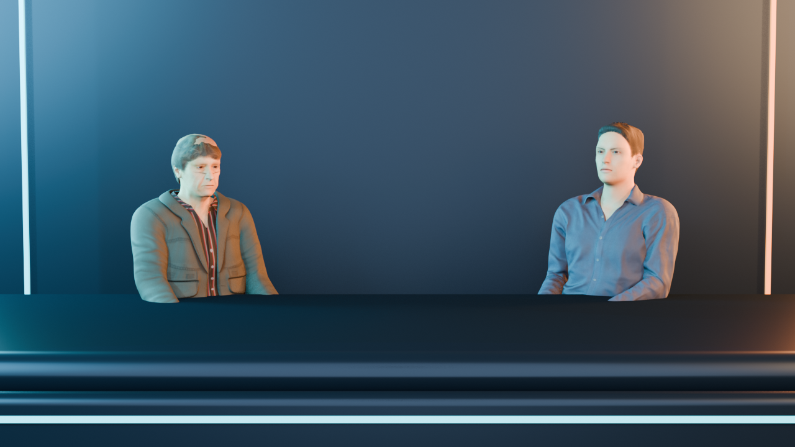
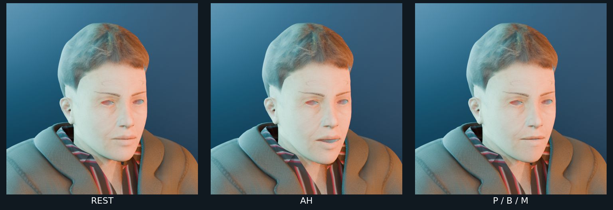

# Rigged-character audition

## Status

This is an isolated look-development study, not a character approval or a
replacement for the live Godot bar study. The poker-table render was rejected
for unnatural shoulders, hairline gaps, twisted hands, body/table intersections,
and stiff motion. Nothing here is approved or integrated into the game.
The models, rigs, Blender project, and external asset packs are not included.

The active direction and next-step gates are documented in the
[Cursor 3D opening handoff](../CURSOR_3D_OPENING_HANDOFF.md).

The original seated still below records the first, silent blocking pass. It
keeps the hands hidden because its source poses did not make reliable contact.
It is a lighting/composition reference only, not an approved character result.

The viseme pack provides visibly different open-mouth and closed-lip poses in
a close-up:

Individual source frames: [neutral](face_rest.png), [AH](face_ah.png), and
[P/B/M](face_pbm.png).

## Rejected poker-table experiment

- [Poker-table render](../renders/ash_meridian_opening_poker_v01.mp4) is a
  failed experiment, not an approved review. Its rough bar set and cyan/amber
  lighting may be useful for reference, but do not copy its character posing,
  hair, hands, body/table intersections, or motion.
- [Subtitles](../renders/ash_meridian_opening_poker_v01.srt) accompany the
  render; they do not imply that the picture or performance was approved.

The render used the existing scratch audio and limited mouth cues; it is not
phoneme-accurate lip sync or a finished performance. The original silent
[facial-motion test](../renders/mark_viseme_motion_audition_v01.mp4) and
[hidden-hand blocking test](../renders/mark_jason_two_shot_motion_audition_v01.mp4)
remain as historical rig-control tests.

## Review

- The prior proxy-character attempt had segmented anatomy and misaligned
  shoulders. The MakeHuman/MPFB attempt improved the set but failed as a
  character/performance solution: skin showed at the hairline, shoulders and
  arms looked unnatural, wrists/fingers were twisted, hand contact was
  unconvincing, and wide shots showed body parts below/through the table.
- The motion keys were too sparse to create believable dialogue acting.
- Treat all images and renders here as diagnostic references only. Select and
  validate a better character/rig before investing in detailed animation.

## Sources and licenses

The audition used MakeHuman Community assets from these packs:

- [MakeHuman system assets](https://static.makehumancommunity.org/assets/assetpacks/makehuman_system_assets.html)
  — CC0 system assets used for the base character support assets, skin, hair,
  clothing, and eyes.
- [poses01](https://static.makehumancommunity.org/assets/assetpacks/poses01.html)
  — CC0 pose pack; the two-shot uses `callharvey3d_sittingdefault` and
  `callharvey3d_sittingnatural`.
- [visemes01](https://static.makehumancommunity.org/assets/assetpacks/visemes01.html)
  — CC0 functional asset pack; Microsoft-style visemes contributed by Mika
  Suominen. The close-ups use `aa_ah_ax_01` and `p_b_m_21`.
- [MakeHuman Community license overview](https://static.makehumancommunity.org/about/license.html)
  — documents CC0 for core assets and GPL for MPFB source code.
- [MPFB2 source repository](https://github.com/makehumancommunity/mpfb2)
  — the Blender extension used to generate the audition; its source and
  Blender itself are not included here.

The models and source packs remain external and are not redistributed in this
folder. The stills are provided here, and rendered reviews are stored in the
opening's central `renders/` folder. None of these are production character
assets.
